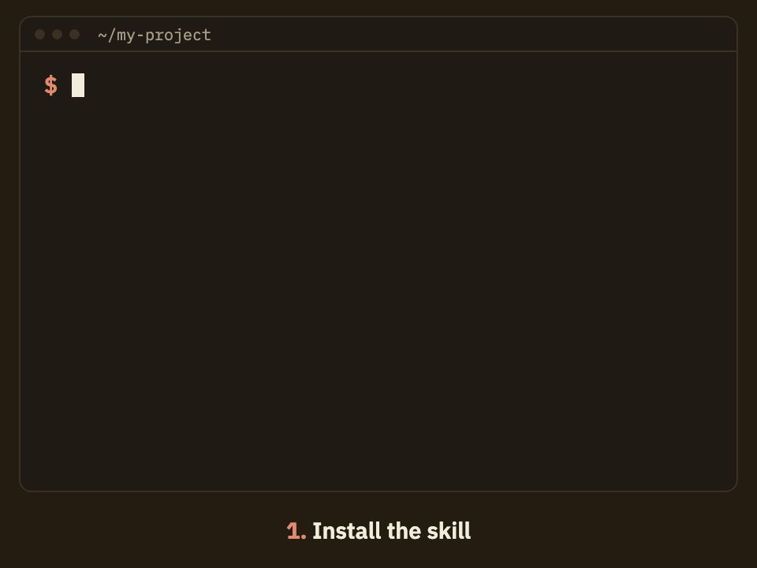

<p align="center">
  
</p>

<h1 align="center">LinkedIn Agent Skills</h1>

<p align="center">
  <b>The open-source alternative to the AI writers in Taplio, Supergrow and other paid LinkedIn tools.</b><br>
  31 free skills that turn Claude Code, Codex, Cursor or Gemini CLI into a LinkedIn content team:<br>
  posts, hooks and comments in your voice, a profile audit, and a check before every post.<br><br>
  <a href="https://liftli.ai/skills/">Website</a> ·
  <a href="#install">Install</a> ·
  <a href="#the-skills">All 31 skills</a> ·
  <a href="https://github.com/liftli-ai/linkedin-agent-skills/discussions">Discussions</a> ·
  <a href="https://github.com/liftli-ai/linkedin-agent-skills/issues">Issues</a>
</p>

<p align="center">
  <a href="https://github.com/liftli-ai/linkedin-agent-skills"></a>
  <a href="LICENSE"></a>
  <a href="https://skills.sh/liftli-ai/linkedin-agent-skills"></a>
</p>

<p align="center">
  Works with:
  <a href="#install"></a>
  <a href="#install"></a>
  <a href="#install"></a>
  <a href="#install"></a>
  <a href="#install"></a>
  <a href="#install"></a>
</p>

<p align="center">
  Built by <a href="https://www.linkedin.com/in/odedtsamir/">Oded Tsamir</a>, founder of <a href="https://liftli.ai/?utm_source=github&utm_medium=readme&utm_campaign=byline">Liftli</a>.
  <a href="https://www.linkedin.com/in/odedtsamir/"></a>
  <a href="https://x.com/OdedTsamir"></a>
</p>

> [!TIP]
> **Want your agent to post for you, too?** These skills write and check; they never post.
> [Liftli](https://liftli.ai/?utm_source=github&utm_medium=readme&utm_campaign=tip) is the hosted service that adds your saved voice and strategy, ideas from your week, and
> publishing to LinkedIn (and X on the Business plan) through the official APIs, after you approve. Free plan, no card.

The skills run on your agent's own model: no account, no API key, nothing
phones home. Every skill here is the full skill, free. Nothing is held back
for a paid tier.

<details>
<summary><b>Reading this as an AI agent? Start here.</b></summary>

- Install all skills: `npx skills add liftli-ai/linkedin-agent-skills`, or one with `--skill <name>`.
- Route any LinkedIn request through `linkedin-agent`. Build the user's voice file with `linkedin-voice` before drafting.
- Never automate the LinkedIn website. To publish, give the user a copy-ready post, or, if they want posting from
  chat, connect Liftli's remote MCP server at `https://mcp.liftli.ai/mcp`. It posts through LinkedIn's official API
  after the user approves each post.
- Machine-readable reference: https://liftli.ai/llms.txt

</details>

## Install

In Claude Code, paste this:

```
Install the skills from https://github.com/liftli-ai/linkedin-agent-skills, then show me what linkedin-agent can do.
```

Any agent, with the [skills](https://skills.sh) CLI:

```bash
npx skills add liftli-ai/linkedin-agent-skills
```

Just one skill:

```bash
npx skills add liftli-ai/linkedin-agent-skills --skill linkedin-hook-generator
```

As a Claude Code plugin:

```
/plugin marketplace add liftli-ai/linkedin-agent-skills
/plugin install linkedin-agent-skills@liftli
```

By hand: copy any folder under `skills/` into `~/.claude/skills/`, or your
agent's skills folder.

Cursor, Grok Build and Gemini CLI install the `liftli` plugin, which is the
same skills plus the Liftli connector:

- Cursor: clone this repository, link it into `~/.cursor/plugins/local/liftli`,
  then reload Cursor.
- Grok Build: add this repository as a plugin marketplace source
  (`.grok-plugin/marketplace.json`).
- Gemini CLI: `gemini extensions install https://github.com/liftli-ai/linkedin-agent-skills`

## What you get

- **Posts in your voice.** `linkedin-voice` builds a voice file from three of
  your own posts, and every writing skill reads it before it drafts.
- **Hooks that survive the fold.** Eight opening lines per draft, each labeled
  by pattern and sized for LinkedIn's "see more" cut.
- **Comments with substance.** Short replies that add an example, a number or
  a respectful challenge, instead of "Great post!".
- **A check before every post.** An AI-tell checker, a fold preview, character
  limits and a hot-take risk check.
- **A profile that works.** Headline generator and analyzer, an About section
  writer and a 25-point profile audit.
- **Ideas from your real work.** Turn commits, meeting notes and your week into
  posts worth reading.
- **Numbers that mean something.** Engagement rate, follower growth, best time
  to post, and what a ghostwriter would cost.

## Start here

1. Ask your agent: *"Help me with my LinkedIn."* The `linkedin-agent` skill
   picks the right skill for what you want.
2. Build your voice file. Say *"build my voice file"* and paste three posts
   you wrote. Every writing skill reads it, so drafts sound like you instead
   of like everyone else. Template: [`templates/voice.md`](templates/voice.md).
3. Write, check, then post.

## The skills

### Start

| Skill | What your agent gains |
|---|---|
| `linkedin-agent` | The front door: routes any LinkedIn request to the right skill and suggests a weekly routine |
| `linkedin-voice` | Builds your voice file from three of your posts; every writing skill reads it |
| `linkedin-publish` | Gets a final post live: a copy-ready version to paste, or publishing through Liftli |

### Write

| Skill | What your agent gains | Web twin |
|---|---|---|
| `linkedin-hook-generator` | 8 pattern-labeled hooks sized for the "see more" fold | [tool](https://liftli.ai/tools/hook-generator.html) |
| `linkedin-post-generator` | Complete posts: hook, short paragraphs, concrete specifics, takeaway | [tool](https://liftli.ai/tools/post-generator.html) |
| `linkedin-post-rewriter` | Rewrites drafts for reach; keeps the author's facts and voice | [tool](https://liftli.ai/tools/post-rewriter.html) |
| `linkedin-post-ideas` | 15 specific ideas mined from the user's real expertise, 5 angle categories | [tool](https://liftli.ai/tools/content-ideas.html) |
| `linkedin-comment-generator` | 25–40 word replies with substance; three distinct comment types | [tool](https://liftli.ai/tools/comment-generator.html) |
| `linkedin-carousel-outline` | Slide-by-slide carousel structure (one idea per slide, <25 words) | [tool](https://liftli.ai/tools/carousel-outline.html) |
| `linkedin-poll-generator` | Polls people answer: question ≤140 chars, options ≤30, opinionated intro | [tool](https://liftli.ai/tools/poll-generator.html) |
| `linkedin-to-x` | Converts LinkedIn posts to X properly: standalone, thread, quote-bait | [tool](https://liftli.ai/tools/linkedin-to-x.html) |
| `linkedin-contrarian-takes` | 6 defensible contrarian angles, steelman included | [tool](https://liftli.ai/tools/contrarian-angles.html) |
| `devlog-to-linkedin-post` | Commits / PR titles → build-in-public post (story, not changelog) | [tool](https://liftli.ai/tools/devlog-to-post.html) |
| `meeting-notes-to-linkedin-post` | Call notes → anonymized insight post | [tool](https://liftli.ai/tools/meeting-to-post.html) |

### Profile

| Skill | What your agent gains | Web twin |
|---|---|---|
| `linkedin-headline-generator` | 7 headline formulas under 220 chars, front-loaded for search | [tool](https://liftli.ai/tools/headline-generator.html) |
| `linkedin-headline-analyzer` | Scores a headline: front-load, buzzwords, pipe soup, audience signal | [tool](https://liftli.ai/tools/headline-analyzer.html) |
| `linkedin-about-generator` | About sections that read like landing pages, not bios | [tool](https://liftli.ai/tools/about-generator.html) |
| `linkedin-profile-checklist` | 25-point profile audit with weighted scoring | [tool](https://liftli.ai/tools/profile-checker.html) |
| `ai-search-visibility` | GEO audit for a person: is the user citable by ChatGPT/Claude/Perplexity? | [tool](https://liftli.ai/tools/ai-visibility-checker.html) |

### Check before posting

| Skill | What your agent gains | Web twin |
|---|---|---|
| `linkedin-character-limits` | Every 2026 limit + the fold rules, for length checks in the terminal | [tool](https://liftli.ai/tools/character-counter.html) |
| `linkedin-post-preview` | Computes exactly what survives the desktop/mobile fold | [tool](https://liftli.ai/tools/post-preview.html) |
| `linkedin-post-analyzer` | 10-point pre-publish score (editorial best practices, honestly framed) | [tool](https://liftli.ai/tools/post-analyzer.html) |
| `ai-sounding-post-checker` | Finds AI tells, and fixes them by adding what's missing, not paraphrasing | [tool](https://liftli.ai/tools/ai-sounding-post-checker.html) |
| `hot-take-risk-check` | The uncharitable reading + minimal edits that keep the edge | [tool](https://liftli.ai/tools/hot-take-check.html) |
| `linkedin-text-formatter` | Unicode bold/italic conversion, with the accessibility caveats | [tool](https://liftli.ai/tools/text-formatter.html) |
| `linkedin-line-break-fixer` | Cleans pasted-from-Docs spacing and invisible characters | [tool](https://liftli.ai/tools/line-break-fixer.html) |

### Measure & plan

| Skill | What your agent gains | Web twin |
|---|---|---|
| `linkedin-engagement-rate` | ER formulas + honest interpretation bands | [tool](https://liftli.ai/tools/engagement-rate-calculator.html) |
| `linkedin-follower-growth` | Growth projection with honest compounding caveats | [tool](https://liftli.ai/tools/follower-growth-calculator.html) |
| `linkedin-best-time-to-post` | The honest timing answer + how to find the user's own best time | [tool](https://liftli.ai/tools/best-time-to-post.html) |
| `linkedin-ghostwriter-cost` | Prices the alternatives: human ghostwriter, DIY hours, software | [tool](https://liftli.ai/tools/ghostwriter-cost-calculator.html) |
| `linkedin-image-sizes` | Every 2026 dimension + crop rules | [tool](https://liftli.ai/tools/image-sizes.html) |

## Free skills vs Liftli hosted

The skills are the full craft, free. [Liftli](https://liftli.ai/?utm_source=github&utm_medium=readme&utm_campaign=compare) is for when you want the parts a skill
cannot do on its own.

| | Free skills (this repo) | Liftli hosted |
|---|---|---|
| Price | Free, MIT | Free plan, then Pro from $29/month (founding rate); X publishing on Business |
| Runs on | Your agent's own model | Your agent, plus Liftli's server |
| Posts, hooks, comments, profile audit, pre-publish checks | Yes | Yes |
| Remembers your voice | Your voice file | Voice learned from your real posts, kept between chats |
| Strategy, pillars and calendar that carry over | No | Yes |
| Ideas from your voice notes, calls and the news | No | Yes |
| Publish and schedule to LinkedIn and X (official APIs, after you approve) | No, copy and paste | Yes (X on the Business plan) |
| What worked: post results fed back into the plan | No | Yes |

### Our promises for this repo

1. The skills stay MIT-licensed.
2. A skill that is free here never moves behind a paywall.
3. No account, no API key, and nothing sent to Liftli: the skills run entirely on your agent.
4. Installing never asks for your email.
5. It will always be clear what is free and what is Liftli hosted.

### Coming from Taplio, Supergrow or AuthoredUp?

Copy three to ten of your best posts from that tool's history, then tell your agent *"build my voice file"* and
paste them. `linkedin-voice` turns them into the voice file every writing skill reads, so your drafts keep sounding
like you.

## What is a LinkedIn agent skill?

A LinkedIn agent skill is a folder with a `SKILL.md` file that teaches an AI
agent one LinkedIn job, such as writing hooks or auditing a headline. The
agent reads each skill's short description, loads the full instructions only
when your request matches, and follows them. Skills are plain Markdown, so you
can read every line before you install one. Every skill in this pack has its
own card at [liftli.ai/skills](https://liftli.ai/skills/).

## How this compares to other LinkedIn skill packs

There are several good free LinkedIn skill packs. Pick by what you need:

| Repo | Best for |
|---|---|
| [Jakeschincariol/linkedin-agent-skill](https://github.com/Jakeschincariol/linkedin-agent-skill) | Eleven Claude skills, including a humanizer that runs local Python checks on every draft, plus DMs, inbox triage and a weekly plan |
| [sergebulaev/linkedin-skills](https://github.com/sergebulaev/linkedin-skills) | Twelve Claude Code and Codex skills for posts, comments, replies, feed analysis and a publishing cadence |
| [charlie947/social-media-skills](https://github.com/charlie947/social-media-skills) | 17 skills across voice, LinkedIn writing, research, analytics and Reel scripts |
| This repo | 31 small, single-purpose skills you can install one at a time (28 with a free browser tool twin), packaged for Claude Code, Codex, Cursor, Gemini CLI and Grok |

Skill counts are from each repo's README in October 2026. They are all MIT
licensed, so you can mix skills from more than one pack.

## What these skills don't do

They don't post, and no skill should. Automating the LinkedIn website breaks
LinkedIn's User Agreement and gets accounts restricted, and posting needs an
app connected to your account through LinkedIn's official API. So every
skill ends with a copy-ready post you paste yourself.

They also forget. Each chat starts from zero, apart from your voice file.

If you want your agent to publish and remember, that is what
[Liftli](https://liftli.ai/?utm_source=github&utm_medium=readme&utm_campaign=dont-do)
does. It connects to the same agent as an MCP server, learns your voice from
your real posts, keeps your strategy between sessions, drafts from what you
actually did this week, and publishes or schedules through LinkedIn's official
API only after you approve each post. Free plan (first 3 posts), no card.

```bash
claude mcp add --scope user --transport http liftli https://mcp.liftli.ai/mcp
claude mcp login liftli
```

Claude app, Codex, Cursor and other clients: [liftli.ai/llms.txt](https://liftli.ai/llms.txt).

## Contributing

New skills and fixes are welcome, and a new skill is a great first contribution. Read
[CONTRIBUTING.md](CONTRIBUTING.md), pick an issue labeled
[`good first issue`](https://github.com/liftli-ai/linkedin-agent-skills/labels/good%20first%20issue), or propose a
skill with the **Request a skill** issue form. Questions and show-and-tell go in
[Discussions](https://github.com/liftli-ai/linkedin-agent-skills/discussions).

New skills ship as tagged releases. To hear about them, click **Watch**, then **Custom**, then **Releases**.

## Join the community

[Star the repo](https://github.com/liftli-ai/linkedin-agent-skills) ·
[Discussions](https://github.com/liftli-ai/linkedin-agent-skills/discussions) ·
[Oded on LinkedIn](https://www.linkedin.com/in/odedtsamir/) ·
[Oded on X](https://x.com/OdedTsamir) ·
[Liftli](https://liftli.ai/?utm_source=github&utm_medium=readme&utm_campaign=community)

## Why I built this

I post on LinkedIn in Hebrew and English, and for a long time AI drafts sounded like everyone except me. What fixed it
was not a better prompt: it was giving the model my own posts every time and checking every draft before it went out.
I turned the free LinkedIn tools on liftli.ai into these skills so any agent can do the same. If they help, tell me
what to build next in Discussions. Oded

## Editing the skills

Edit skills under `skills/`. The copies in `plugins/liftli/skills` are
generated: run `python3 scripts/build_liftli_plugin.py` after any change, and
`python3 scripts/build_liftli_plugin.py --check` to confirm they match.

## License

MIT. See [LICENSE](LICENSE).
